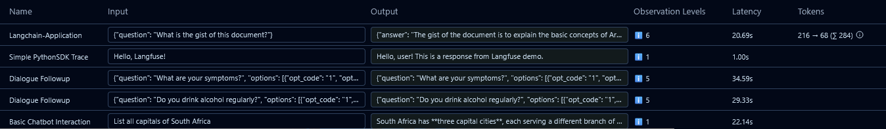
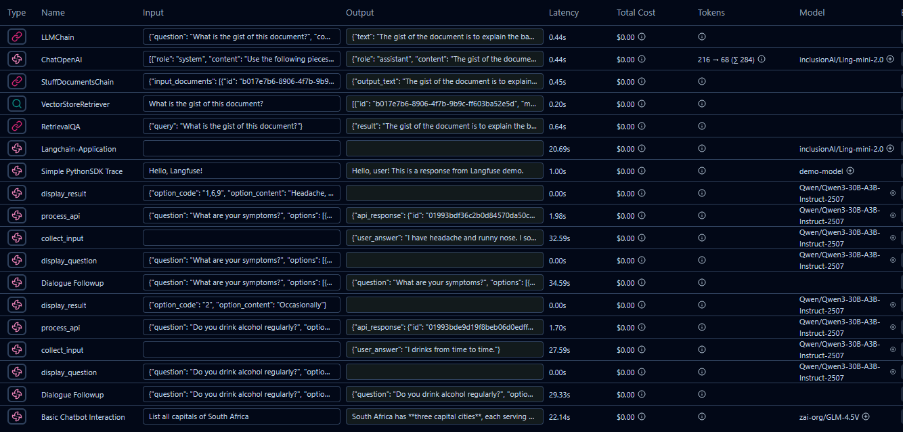

# Langfuse Python SDK Examples

> **Note:** All examples assume proper environment configuration with API keys for Silicon Flow and Langfuse services.

## Basic_Tracing.py

**Purpose:**  
Demonstrates a basic chatbot interaction using the Silicon Flow API and Langfuse for tracing. The script collects user input, sends it to a language model, receives a response, and logs the interaction with Langfuse for observability and traceability.

**Code Structure:**
`

- **Imports**: OpenAI client, Langfuse SDK, and os for environment variables
- **Configuration**: Sets up API keys for Silicon Flow and Langfuse services
- **Main Flow**:
  - Initializes OpenAI client with Silicon Flow base URL
  - Creates Langfuse trace with observation context
  - Collects user input via console
  - Makes API call to Silicon Flow LLM model
  - Updates trace with input/output data
  - Flushes traces to Langfuse platform

**Terminal Output:**

```console
PS C:\LLM\Big Data_Project\Langfuse_Project> python Basic_Tracing.py
Enter your question: List all capitals of South Africa

South Africa has **three capital cities**, each serving a different branch of government:

1.  **Pretoria:** The **administrative capital** (seat of the executive branch, where the President and government departments are located).
2.  **Cape Town:** The **legislative capital** (seat of the national legislature, including the National Assembly and National Council of Provinces).
3.  **Bloemfontein:** The **judicial capital** (seat of the Supreme Court of Appeal).

Here's the list:

*   **Administrative Capital:** Pretoria (Gauteng province)
*   **Legislative Capital:** Cape Town (Western Cape province)
*   **Judicial Capital:** Bloemfontein (Free State province)

**Johannesburg** is a major city and the largest urban center in South Africa, but it is **not** a national capital.
```

---

## Dialogue_Followup_Langfuse.py

**Purpose:**  
Implements a dialogue follow-up system with advanced tracing using Langfuse. It defines a workflow for multi-turn dialogue, manages state, processes user input, interacts with an AI model, and logs all steps and results for robust traceability and debugging.

**Code Structure:**

- **Imports**: LangGraph for workflow management, Langfuse for tracing, requests for API calls
- **Constants**: API configuration, timeout settings, and default model name
- **DialogueState**: TypedDict defining the state structure for workflow data
- **VoiceFollowUp Class**:
  - `__init__()`: Initializes API clients and builds workflow
  - `_build_workflow()`: Creates LangGraph workflow with nodes and edges
  - Workflow nodes: display_question, collect_input, process_api, display_result
  - `_build_api_payload()`: Constructs API request with improved matching prompts
  - `process_question()`: Main method to execute workflow with Langfuse tracing
- **Demo Function**: `run_demo()` with example single/multiple choice questions

**Terminal Output:**

```console
PS C:\LLM\Big Data_Project\Langfuse_Project> python Dialogue_Followup_Langfuse.py

============================================================
DIALOGUE FOLLOW-UP DEMO
============================================================

Single-Choice Question

Single-Choice Question: Do you drink alcohol regularly?
Available Options:
  1. Frequently
  2. Occasionally
  3. Never

Please enter your answer: I drinks from time to time.
Processing your answer...

============================== RESULTS ==============================
Best Match Found!
Option: 2 - Occasionally

============================================================
Waiting 5 seconds before the next question...

Multiple-Choice Question

Multiple-Choice Question: What are your symptoms?
Available Options:
  1. Headache
  2. Dizziness
  3. Blurred vision
  4. Sore throat
  5. Sneezing
  6. Runny nose
  7. Nasal congestion
  8. Chest tightness
  9. General weakness

Please enter your answer: I have headache and runny nose. I sometimes also feel tired.
Processing your answer...

============================== RESULTS ==============================
Best Match Found!
Option: 1,6,9 - Headache, Runny nose, General weakness

============================================================
Demo completed successfully!
```

---

## Langfuse_PythonSDK.py

**Purpose:**  
Provides a simple example of using the Langfuse Python SDK to create and send traces and observations. It shows how to authenticate with Langfuse, start a trace, log input and output, and ensure all data is sent to the Langfuse UI.

**Code Structure:**

- **Imports**: Langfuse SDK, time module for simulation, os for environment variables
- **Configuration**: Sets environment variables for Langfuse authentication
- **main() Function**:
  - Gets Langfuse client instance
  - Creates observation context with trace metadata
  - Simulates user input and processing
  - Updates trace with input/output data
  - Flushes traces to ensure delivery
- **Entry Point**: `if __name__ == "__main__"` block to execute main function

**Terminal Output:**

```console
PS C:\LLM\Big Data_Project\Langfuse_Project> python Langfuse_PythonSDK.py
Trace sent to Langfuse UI.
```

---

## RAG_Application.py

**Purpose:**  
Implements a Retrieval-Augmented Generation (RAG) application with Langfuse tracing. The script loads and processes documents, splits them into chunks, uses vector search for retrieval, and integrates with language models for question answering, while logging all interactions and results with Langfuse.

**Code Structure:**

- **Imports**: LangChain components, FAISS for vector storage, Langfuse for tracing
- **Configuration**: Document settings, API keys, model configurations, user/session IDs
- **Core Functions**:
  - `setup_environment()`: Configures environment variables for APIs
  - `load_and_process_documents()`: Loads text files and splits into chunks
  - `create_vector_store()`: Creates FAISS vector database from document chunks
  - `setup_rag_chain()`: Initializes RetrievalQA chain with LLM and vector store
  - `main()`: Orchestrates the RAG pipeline with Langfuse tracing
- **Integration**: Uses Langfuse CallbackHandler for automatic LangChain tracing
- **Error Handling**: File existence checks and proper exception management

**Terminal Output:**

```console
PS C:\LLM\Big Data_Project\Langfuse_Project> python RAG_Application.py
Starting RAG Application with Langfuse Tracing
============================================================

Ready for questions!
Enter your question: What is the gist of this document?

==================================================
ANSWER:
==================================================
The gist of the document is to explain the basic concepts of Artificial Intelligence (AI), Machine Learning (ML), and Deep Learning. It describes how AI aims to create intelligent machines, ML focuses on systems that learn from data to improve over time, and Deep Learning uses multi-layered neural networks to solve complex problems by learning from large datasets.
Processing complete! Check Langfuse for detailed traces.

Traces sent to Langfuse dashboard
```

---

## Conclusion

  
!-- 

Similarities and differences between Langfuse and Langgraph:
Similarities:
-Both Langfuse and LangGraph are used in LLM application development and observability.
-Each can be integrated into Python workflows for tracing, debugging, and monitoring LLM interactions.
-Both support multi-step workflows and can be used together for advanced tracing.

Differences:
-Langfuse is primarily a tracing and observability platform, focused on logging, visualizing, and analyzing LLM application traces and metrics.
-LangGraph is a workflow orchestration library for building stateful, multi-step LLM applications (like dialogue systems or agents).
-Langfuse is about monitoring and analytics; LangGraph is about structuring and executing workflows.
-Langfuse integrates with many frameworks (including LangChain, LangGraph) for trace collection, while LangGraph is a framework for building the workflows themselves.
